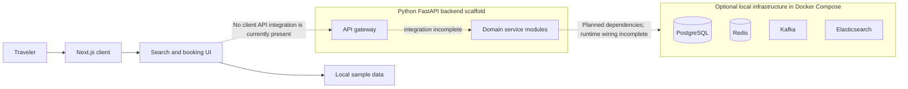

# Moveo

Moveo is a travel-booking web application focused on **flights, hotels, and buses**. It is designed for travelers who want to explore these options through one interface. The repository contains a polished Next.js client and a Python/FastAPI backend scaffold; live search, authentication, and booking are not yet connected end to end.

> **Project status:** The client is a UI prototype that uses local sample data for travel listings. Backend services and API handlers are incomplete. Do not use the current project to make real reservations or payments.

## Contents

- [Features](#features)
- [Technology stack](#technology-stack)
- [Demo and screenshots](#demo-and-screenshots)
- [Architecture](#architecture)
- [Repository structure](#repository-structure)
- [Prerequisites](#prerequisites)
- [Local setup](#local-setup)
- [Environment variables](#environment-variables)
- [API status](#api-status)
- [Database](#database)
- [Available scripts](#available-scripts)
- [Deployment](#deployment)
- [Security](#security)
- [Planned improvements](#planned-improvements)
- [Contributing](#contributing)
- [License](#license)

## Features

The client currently includes:

- Search interfaces for flights, hotels, and buses.
- Sample flight and bus listing data and curated hotel destination cards.
- Booking-page UI with category-specific travel search flows.
- Login, signup, profile, and dashboard interfaces.
- Community and destination discovery sections.
- Theme support, responsive layouts, and reusable UI components.

These are client-side interfaces and demonstrations. The repository does not currently contain a complete backend integration for live inventory, secure authentication, reservations, or payment processing.

## Technology stack

| Area | Technologies in the repository |
|---|---|
| Client | Next.js 16, React 19, TypeScript |
| Styling and UI | Tailwind CSS 4, React Icons, Hugeicons |
| Client state and forms | Redux Toolkit, React Hook Form, Zod |
| Animation and scrolling | GSAP, `@gsap/react`, Lenis |
| Charts and utilities | Recharts, `date-fns` |
| Backend scaffold | Python 3.11+, FastAPI, SQLAlchemy async |
| Backend dependencies declared | PostgreSQL/asyncpg, Redis, Kafka, Elasticsearch, JWT-related libraries |
| Local backend infrastructure | Docker Compose with PostgreSQL, Redis, Kafka, and Elasticsearch |

Backend technologies are declared in dependency and Compose files, but the backend is incomplete and should not be considered an operational production stack.

## Demo and screenshots

No live demo URL or dedicated application screenshots are configured in the repository. The images under `client/public/images/` are application assets, not verified screenshots of the running product.

## Architecture



The diagram distinguishes the working client prototype from backend and infrastructure scaffolding. The client source contains no configured API client or environment-based backend URL.

## Repository structure

```text
.
├── client/                 Next.js application
│   ├── public/             Static assets
│   └── src/
│       ├── app/            Application routes and layouts
│       ├── components/     Shared page and UI components
│       ├── data/           Client-side sample/reference data
│       ├── providers/      Theme and application providers
│       ├── store/          Redux store and slices
│       └── types/          TypeScript types
├── backend/                FastAPI service scaffold
│   ├── gateway/            API gateway package (incomplete)
│   ├── services/           Domain service modules and route stubs
│   ├── shared/             Shared backend package (incomplete)
│   ├── docker-compose.infra.yml
│   ├── docker-compose.yml
│   ├── .env.example
│   └── pyproject.toml
├── ai-service/             Planned AI module directories; no implementation yet
├── infrastructure/         Planned deployment directories; no manifests yet
└── docs/                   Project documentation and diagrams
```

The backend lives in `backend/`; there is no root-level `server/` directory.

## Prerequisites

For the client:

- Node.js 20.9 or newer (the installed Next.js package declares `node >=20.9.0`).
- npm.

For optional local backend dependencies:

- Docker Engine or Docker Desktop.
- Docker Compose v2 (`docker compose`).

Python 3.11 or newer is declared for backend development in `backend/pyproject.toml`. The backend services are incomplete, so installing Python dependencies alone does not produce a working API.

## Local setup

### 1. Clone the repository

```bash
git clone https://github.com/AdityaSGaur/moveo.git
cd moveo
```

### 2. Install and run the client

```bash
cd client
npm ci
npm run dev
```

Open [http://localhost:3000](http://localhost:3000).

### 3. Optional: start local backend infrastructure

From the repository root, run:

```bash
docker compose -f backend/docker-compose.infra.yml up -d
```

This starts only the PostgreSQL, Redis, Kafka, and Elasticsearch containers. It does **not** start a complete backend API. The full backend Compose stack references incomplete service and gateway modules and is not a verified local startup path.

## Environment variables

The client has no environment variables configured for an API URL or other runtime integration.

`backend/.env.example` documents intended backend settings. It is a template, not proof that every variable is currently loaded by the incomplete service code. Variable names present in that template include:

- Application: `APP_NAME`, `APP_ENV`, `DEBUG`, `LOG_LEVEL`
- PostgreSQL: `POSTGRES_USER`, `POSTGRES_PASSWORD`, `POSTGRES_HOST`, `POSTGRES_PORT`
- Service database URLs: `DATABASE_URL_AUTH`, `DATABASE_URL_INVENTORY`, `DATABASE_URL_BOOKING`, `DATABASE_URL_PAYMENT`, `DATABASE_URL_NOTIFICATION`, `DATABASE_URL_REVIEW`, `DATABASE_URL_LOYALTY`
- Dependencies: `REDIS_URL`, `KAFKA_BOOTSTRAP_SERVERS`, `ELASTICSEARCH_URL`
- JWT settings: `JWT_SECRET_KEY`, `JWT_ALGORITHM`, `JWT_ACCESS_TOKEN_EXPIRE_MINUTES`, `JWT_REFRESH_TOKEN_EXPIRE_DAYS`
- Cross-origin settings: `CORS_ORIGINS`

Use private local values; do not copy development credentials into production. A safe placeholder example for a future local backend configuration is:

```dotenv
APP_ENV=development
DEBUG=false
POSTGRES_USER=<local-database-user>
POSTGRES_PASSWORD=<local-database-password>
JWT_SECRET_KEY=<generate-a-unique-random-secret>
CORS_ORIGINS=["http://localhost:3000"]
```

The example above is illustrative and is not a complete backend configuration. Consult `backend/.env.example` for the full set of documented variable names.

## API status

There is no complete, runnable API contract or verified API documentation URL in the repository. The flight and bus inventory route modules declare search/detail operations (and a bus seat-layout operation), but their handler bodies are unfinished. The inventory service entry point and gateway entry point are empty, and the hotel client currently has no corresponding backend API implementation.

Because these route handlers are stubs and are not wired into a running service, they should not be treated as usable endpoints. The client currently does not call them.

## Database

The infrastructure Compose file declares PostgreSQL 16 and provides a local development container. Start it together with the other declared dependencies using the command in [Local setup](#local-setup).

SQLAlchemy and the PostgreSQL async driver are listed as backend dependencies, and the repository includes some model files. However, no verified migration workflow or seed command is configured in the project files. Database schema creation and populated production-ready data are not provided as a working setup path.

The Compose database credentials are development defaults. Do not expose them to a public or production environment.

## Available scripts

Run these commands from `client/`:

| Command | Purpose |
|---|---|
| `npm run dev` | Start the Next.js development server |
| `npm run build` | Build the client for production |
| `npm run start` | Start the production Next.js server after building |
| `npm run lint` | Run ESLint |

The backend `pyproject.toml` configures pytest discovery under service test directories, but no backend test command is provided as a project script. Backend test readiness and coverage may vary.

## Deployment

No verified public deployment URL or production deployment workflow is configured in the repository. The client provides the standard Next.js build and start scripts. The backend deployment and full Compose startup are incomplete and have not been documented as production-ready.

The directories under `infrastructure/` are planned scaffolding; they do not currently provide verified Kubernetes manifests, Nginx configuration, or Terraform modules.

## Security

- Never commit `.env`, `.env.local`, credentials, private keys, or production secrets.
- Generate a unique, high-entropy JWT secret for any real backend deployment; never use example or development values.
- Restrict CORS to trusted origins when backend CORS configuration is implemented.
- The current client stores its demo user state in browser `localStorage`; this is not secure server-side authentication.
- Do not enter real payment details or rely on this prototype for actual travel bookings.

## Planned improvements

The following items are incomplete or identified by existing TODOs and should be treated as future work:

- Implement and verify backend gateway and service entry points.
- Connect client search and account flows to authenticated backend APIs.
- Replace static travel samples with real, validated inventory data.
- Implement hotel API support and complete the flight and bus inventory handlers.
- Add database migrations, seed instructions where appropriate, and backend tests.
- Add deployment configuration only after the application stack is runnable and reviewed.

## Contributing

1. Open an issue describing the problem or proposed change.
2. Create a focused branch and keep changes scoped to one improvement.
3. Follow the existing TypeScript/React and Python patterns.
4. Run the relevant client checks (`npm run lint` and/or `npm run build`) for client changes.
5. Include a clear summary and validation steps in your pull request.

Avoid committing secrets, generated build output, or unrelated project files.

## License

No license file or configured license was found in the repository. All rights remain with the respective authors unless a license is added.
