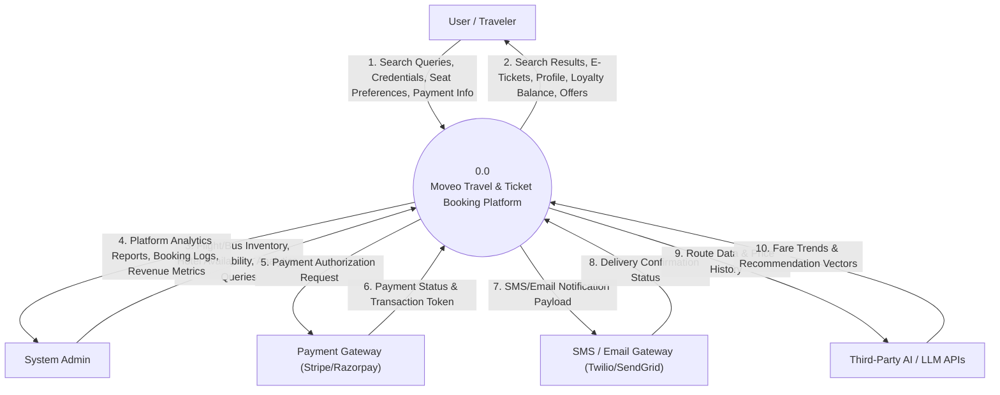
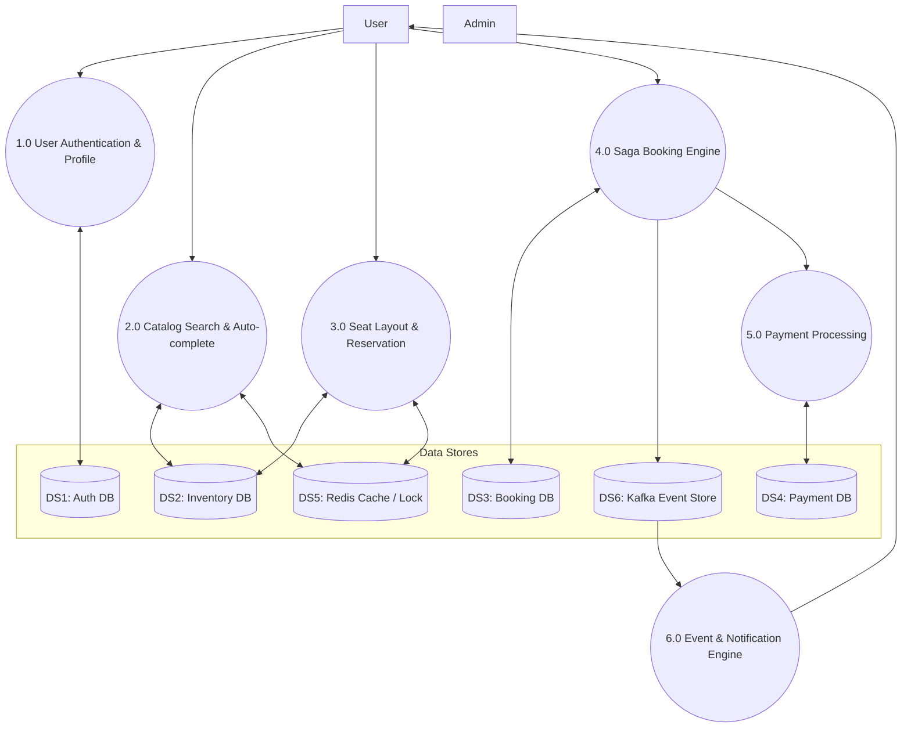
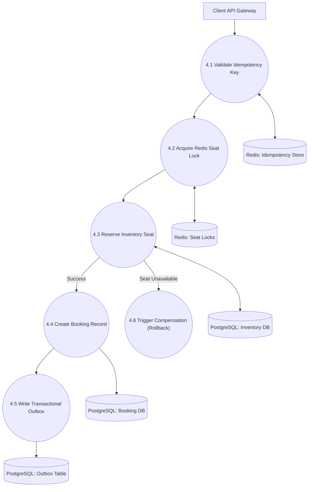
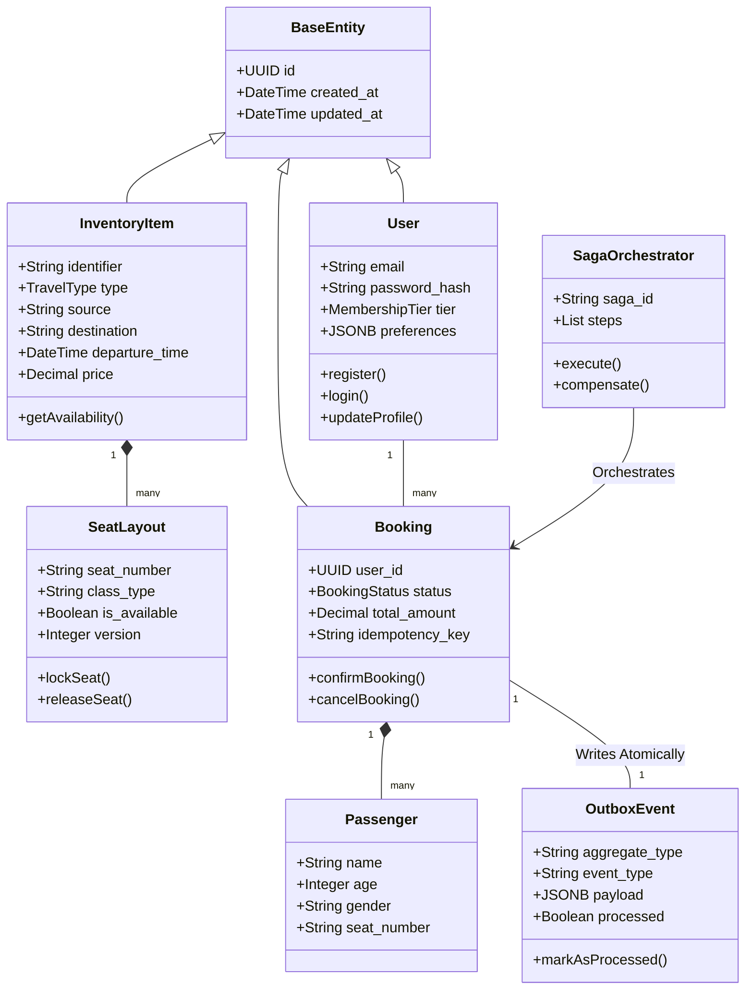
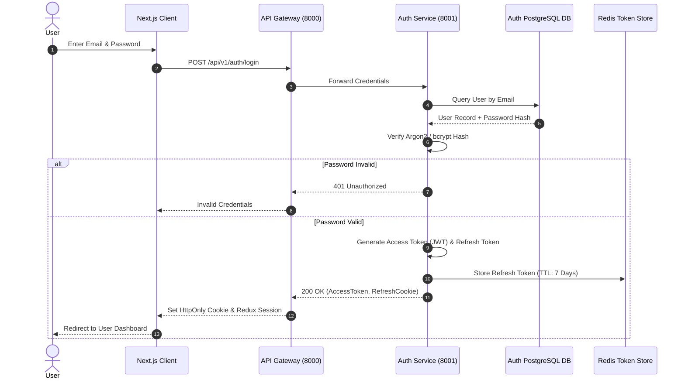
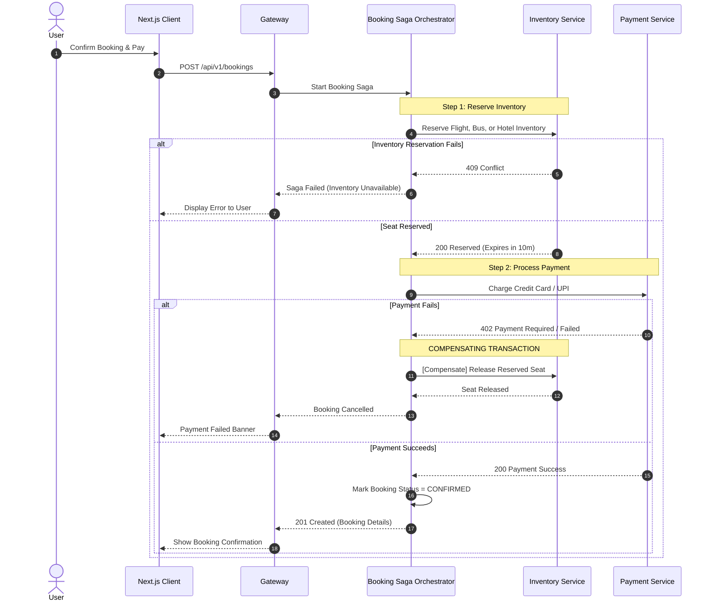
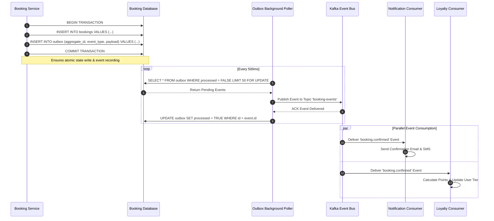
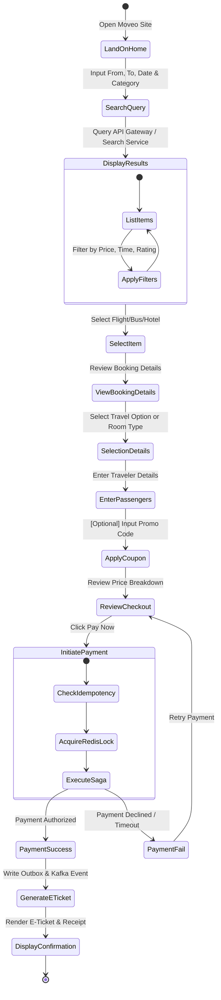
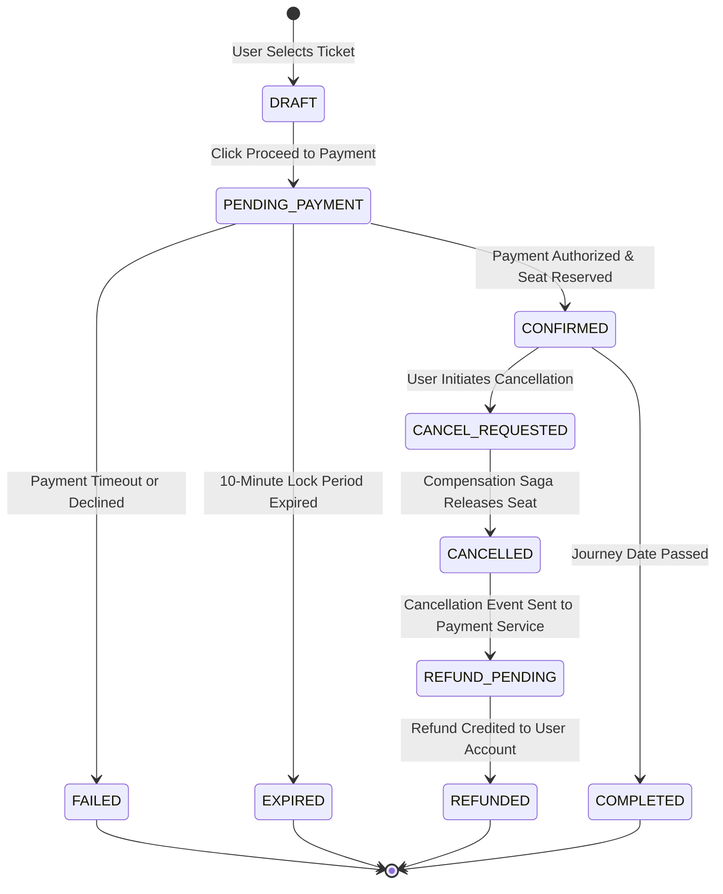
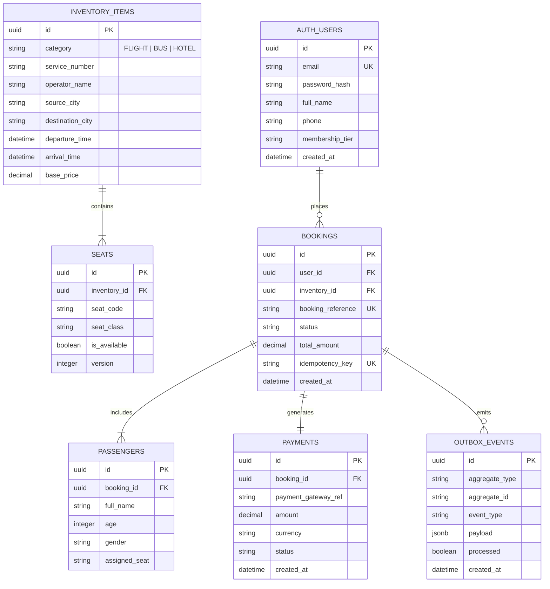

# 🎓 Moveo Platform — MCA Final Year Major Project Blueprint
## Comprehensive Software Engineering Diagram & Documentation Guide

> **Project Title:** Moveo — Enterprise Distributed Multi-Modal Travel & Ticket Booking Platform  
> **Course / Degree:** Master of Computer Applications (MCA) — 1-Year Final Major Project  
> **Architecture Stack:** Next.js (Frontend), Python FastAPI (10 Microservices), Apache Kafka (Event Bus), Redis (Distributed Lock & Cache), PostgreSQL (Database-per-Service), Elasticsearch (Search), PyTorch/Scikit-Learn (AI Engine), Docker Compose / Kubernetes (Deployment).

---

## 📑 Table of Contents
1. [Academic vs. Industry Expectations for MCA Major Projects](#1-academic-vs-industry-expectations-for-mca-major-projects)
2. [Master Diagram Checklist & Report Placement](#2-master-diagram-checklist--report-placement)
3. [Section A: Classical Data Flow Diagrams (DFD)](#3-section-a-classical-data-flow-diagrams-dfd)
   - [DFD Level 0 (Context Diagram)](#dfd-level-0-context-diagram)
   - [DFD Level 1 (Functional System Decomposition)](#dfd-level-1-functional-system-decomposition)
   - [DFD Level 2 (Booking & Saga Engine Decomposition)](#dfd-level-2-booking--saga-engine-decomposition)
4. [Section B: Object-Oriented & Structural UML Diagrams](#4-section-b-object-oriented--structural-uml-diagrams)
   - [Unified Use Case Diagram](#unified-use-case-diagram)
   - [Detailed Class Diagram](#detailed-class-diagram)
   - [Deployment & Physical Component Diagram](#deployment--physical-component-diagram)
5. [Section C: Behavioral & Interaction UML Diagrams](#5-section-c-behavioral--interaction-uml-diagrams)
   - [Sequence Diagram 1: User Authentication & JWT Flow](#sequence-diagram-1-user-authentication--jwt-flow)
   - [Sequence Diagram 2: Saga Distributed Booking & Compensation](#sequence-diagram-2-saga-distributed-booking--compensation)
   - [Sequence Diagram 3: Transactional Outbox & Event Publishing](#sequence-diagram-3-transactional-outbox--event-publishing)
   - [Master Activity Diagram (End-to-End User Booking Journey)](#master-activity-diagram-end-to-end-user-booking-journey)
   - [State Transition Diagram (Booking Lifecycle)](#state-transition-diagram-booking-lifecycle)
6. [Section D: Database Schema & Entity Modeling](#6-section-d-database-schema--entity-modeling)
   - [Database-per-Service ER Diagram](#database-per-service-er-diagram)
7. [Section E: Viva Voce & Defense Strategy](#7-section-e-viva-voce--defense-strategy)

---

## 1. Academic vs. Industry Expectations for MCA Major Projects

In an MCA 1-Year Major Project, university evaluators look for **two key dimensions**:

1. **Standard Academic Compliance**: DFDs (Level 0, 1, 2), UML Use Case, ERD, Class Diagram, Sequence Diagram, Activity Diagram, and Deployment Diagram.
2. **Advanced Architectural Distinction**: Standard college projects are simple monolithic CRUD applications. Moveo stands out because it implements **Microservices**, **Saga Pattern for Distributed Transactions**, **Transactional Outbox**, **Kafka Event-Driven Architecture**, and **AI-Assisted Fare Prediction**. Showing diagrams of these patterns will guarantee top marks.

---

## 2. Master Diagram Checklist & Report Placement

| Diagram Name | Type | Project Report Chapter / Section | Essential for Synopsis? | Essential for Final Viva? |
| :--- | :--- | :--- | :---: | :---: |
| **DFD Level 0 (Context)** | Structured Analysis | Chapter 3: System Requirements & DFDs | **Yes** | **Yes** |
| **DFD Level 1** | Structured Analysis | Chapter 3: System Requirements & DFDs | **Yes** | **Yes** |
| **DFD Level 2 (Booking Core)** | Structured Analysis | Chapter 3: System Requirements & DFDs | Optional | **Yes** |
| **Use Case Diagram** | UML Behavioral | Chapter 4: System Design Document (SDD) | **Yes** | **Yes** |
| **High-Level System Architecture** | Architectural | Chapter 4: System Design Document (SDD) | **Yes** | **Yes** |
| **ER Diagram (ERD)** | Data Modeling | Chapter 4: Database Design | **Yes** | **Yes** |
| **Class Diagram** | UML Structural | Chapter 4: Detailed Object Design | Optional | **Yes** |
| **Sequence Diagram (Saga)** | UML Behavioral | Chapter 4/5: Process Interventions & Workflows | Optional | **Yes** |
| **Activity Diagram** | UML Behavioral | Chapter 4: Workflow Modeling | **Yes** | **Yes** |
| **State Machine Diagram** | UML Behavioral | Chapter 4: State Analysis | Optional | **Yes** |
| **Deployment Diagram** | UML Structural | Chapter 5: Deployment & Environment | Optional | **Yes** |

---

## 3. Section A: Classical Data Flow Diagrams (DFD)

### DFD Level 0 (Context Diagram)
The Context Diagram establishes the system boundary for Moveo and its external entities.



---

### DFD Level 1 (Functional System Decomposition)



---

### DFD Level 2 (Booking & Saga Engine Decomposition)



---

## 4. Section B: Object-Oriented & Structural UML Diagrams

### Unified Use Case Diagram

```mermaid
graph LR
    actor User as "Traveler / User"
    actor Admin as "Platform Admin"
    actor Worker as "Kafka Worker / Background Job"

    subgraph Moveo Ticket Booking Platform
        usecase UC1 as "Register & Login (JWT)"
        usecase UC2 as "Search Flights / Buses / Hotels"
        usecase UC3 as "Filter by Price, Duration, Amenities"
        usecase UC4 as "View Interactive Seat Layout"
        usecase UC5 as "Select Seat & Lock Inventory"
        usecase UC6 as "Apply Discount / Redeem Points"
        usecase UC7 as "Complete Payment"
        usecase UC8 as "Receive Ticket via Email/SMS"
        usecase UC9 as "Cancel Ticket & Request Refund"
        usecase UC10 as "Ask AI Assistant / Fare Predictor"
        
        usecase UC11 as "Manage Routes & Schedules"
        usecase UC12 as "View Platform Revenue Analytics"

        usecase UC13 as "Dispatch Transactional Outbox Events"
        usecase UC14 as "Process Loyalty Point Accrual"
    end

    User --> UC1
    User --> UC2
    User --> UC4
    User --> UC5
    User --> UC7
    User --> UC9
    User --> UC10

    UC2 .-> UC3 : <<include>>
    UC5 .-> UC6 : <<extend>>
    UC7 .-> UC8 : <<include>>

    Admin --> UC11
    Admin --> UC12

    Worker --> UC13
    Worker --> UC14
```

---

### Detailed Class Diagram



---

### Deployment & Physical Component Diagram

```mermaid
graph TB
    subgraph Client Infrastructure
        BROWSER["User Web Browser / Mobile Device"]
    end

    subgraph Ingress & Gateway Layer (Docker Network: public_net)
        NGINX["Nginx / Gateway Controller (Port 8000)"]
    end

    subgraph Application Tier (Docker Network: app_net)
        AUTH_SVC["Auth Service (Port 8001)"]
        INV_SVC["Inventory Service (Port 8002)"]
        SEARCH_SVC["Search Service (Port 8003)"]
        BOOK_SVC["Booking Service (Port 8004)"]
        PAY_SVC["Payment Service (Port 8005)"]
        NOTIF_SVC["Notification Service (Port 8006)"]
        AI_SVC["AI Recommendation Engine"]
    end

    subgraph Data & Storage Tier (Docker Network: db_net)
        PG_AUTH[("PostgreSQL: moveo_auth")]
        PG_INV[("PostgreSQL: moveo_inventory")]
        PG_BOOK[("PostgreSQL: moveo_booking")]
        PG_PAY[("PostgreSQL: moveo_payment")]
        REDIS_CACHE[("Redis Master Cluster: Port 6379")]
        ES_CLUSTER[("Elasticsearch Node: Port 9200")]
        KAFKA_BROKER["Apache Kafka Broker: Port 9092"]
    end

    BROWSER -- "HTTPS (Port 443 / 8000)" --> NGINX
    NGINX --> AUTH_SVC
    NGINX --> INV_SVC
    NGINX --> SEARCH_SVC
    NGINX --> BOOK_SVC
    NGINX --> PAY_SVC
    NGINX --> AI_SVC

    AUTH_SVC --> PG_AUTH
    INV_SVC --> PG_INV
    SEARCH_SVC --> ES_CLUSTER
    BOOK_SVC --> PG_BOOK
    PAY_SVC --> PG_PAY

    BOOK_SVC --> REDIS_CACHE
    INV_SVC --> REDIS_CACHE

    BOOK_SVC -- "Publish Outbox Events" --> KAFKA_BROKER
    PAY_SVC -- "Publish Payment Events" --> KAFKA_BROKER
    KAFKA_BROKER -- "Consume Events" --> NOTIF_SVC
```

---

## 5. Section C: Behavioral & Interaction UML Diagrams

### Sequence Diagram 1: User Authentication & JWT Flow



---

### Sequence Diagram 2: Saga Distributed Booking & Compensation



---

### Sequence Diagram 3: Transactional Outbox & Event Publishing



---

### Master Activity Diagram (End-to-End User Booking Journey)



---

### State Transition Diagram (Booking Lifecycle)



---

## 6. Section D: Database Schema & Entity Modeling

### Database-per-Service ER Diagram



---

## 7. Section E: Viva Voce & Defense Strategy

When defending Moveo in your MCA final project viva, examiners will ask specific architectural questions. Here are the top questions and exact model answers:

### Q1: "Why did you choose a Microservices architecture instead of a Monolith?"
> **Model Answer:** "A travel booking platform handles disparate workloads. Search queries have high read volume (100:1 read-to-write ratio), while booking and payments require strict consistency and high write transaction processing. With a monolith, scaling search scales the whole app. In Moveo, microservices allow independent horizontal scaling, isolated database-per-service performance, and fault isolation (e.g., if Recommendation fails, Booking remains 100% operational)."

### Q2: "How do you handle Distributed Transactions across independent databases?"
> **Model Answer:** "In a microservices environment, traditional 2PC (Two-Phase Commit) locks databases across networks and does not scale. Moveo uses the **Saga Pattern (Orchestration)** managed by the Booking Service. If payment fails after reserving a seat, the Saga Orchestrator automatically fires a compensating transaction to release the seat in the Inventory service."

### Q3: "What happens if the database updates but the event notification fails to publish to Kafka?"
> **Model Answer:** "We solved the Dual-Write problem using the **Transactional Outbox Pattern** ([`backend/shared/patterns/outbox.py`](file:///c:/Users/adity/Desktop/mern_projects(original)/ticket_booking_webapp/backend/shared/patterns/outbox.py)). Instead of writing to Kafka directly inside the HTTP request, the DB transaction commits both the booking record and an event payload into an `outbox` table in the *same* local database transaction. A separate background worker reads from the `outbox` table and publishes to Kafka with at-least-once delivery guarantees."

### Q4: "How do you prevent double-booking or double-payment if a user clicks 'Pay' twice?"
> **Model Answer:** "We implement **Idempotency middleware** using a unique `X-Idempotency-Key` header generated on the Next.js client for every booking attempt. The API Gateway stores this key in Redis SET-NX with a lock timeout. Duplicate requests with the same key are caught at the gateway and returned cached responses without re-executing payment or seat allocation."

---
*Created for Moveo MCA Final Year Major Project — 2026/2027 Session.*
